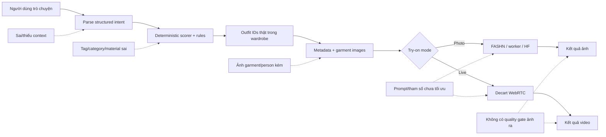

# Giải pháp cải thiện chất lượng Stylist AI → Virtual Try-on

> Ngày phân tích: 10/11/2026 (Asia/Ho_Chi_Minh)<br>
> Phạm vi: SHADOW PWA/FastAPI hiện tại, luồng hội thoại Stylist AI, photo VTON và Decart live VTON.<br>
> Mục tiêu: tăng độ đúng của bộ phối và độ trung thực của ảnh/video đầu ra mà vẫn giữ các invariant, privacy và giới hạn giấy phép.

## 1. Kết luận điều hành

Frontend thay quần áo **đã được triển khai**, gồm:

- Stylist chat chuyển outfit bằng primitive item IDs sang `#/tryon-live` hoặc `#/tryon-photo`;
- live camera: camera/network/framing preflight, client token, WebRTC, đổi outfit bằng `setImage()` trong cùng phiên, idle/session cap và cleanup;
- photo: chụp/tải ảnh, progress/cancel, cảnh báo capability, so sánh trước–sau, lưu/chia sẻ và fallback;
- mock mode để chạy demo không cần key.

Nút thắt chất lượng hiện không nằm ở việc thiếu màn hình, mà nằm ở năm chỗ:

1. ảnh người và ảnh garment chưa có quality gate đủ chặt;
2. metadata/prompt garment có thể thiếu material, pattern, fit hoặc sai category;
3. FASHN đang hard-code `balanced`, một sample và JPEG, chưa có quality tier/retry policy;
4. photo outfit áo + quần chạy tuần tự nên có nguy cơ tích lũy sai lệch khuôn mặt, cơ thể và món đã vẽ ở lượt trước;
5. chưa có bộ eval ảnh thật để chọn cấu hình/provider dựa trên số liệu.

Khuyến nghị tổng quát:

- giữ deterministic scorer/guard làm source of truth cho Stylist;
- bổ sung quality gate và metadata confidence trước khi gọi provider;
- dùng FASHN `tryon-v1.6` làm **preview nhanh**, benchmark `tryon-max` làm **ảnh chất lượng cao**;
- giữ Decart làm live mirror nhưng cải thiện garment normalization và prompt;
- thêm post-generation quality gate và consented evaluation set trước khi tự động promote kết quả.

## 2. Luồng hiện tại và nơi chất lượng bị mất



### 2.1 Phần đang làm đúng và nên giữ

- LLM không được tự tạo item; item ID phải tồn tại trong wardrobe.
- Hard rule, weather, anchor, exclusion và learned rule được kiểm tra bằng code.
- Provider lỗi có deterministic fallback thay vì làm dead-end hội thoại.
- `description_en` đã tồn tại để tạo prompt VTON.
- Decart permanent key nằm ở backend, browser chỉ nhận client token.
- Live UI đã có pose/framing và network preflight.
- Photo UI công khai provider/fallback và gắn nhãn mock rõ ràng.

### 2.2 Khoảng trống hiện tại

| Khoảng trống | Hệ quả chất lượng |
|---|---|
| Không reject ảnh garment mờ, nền rối, có người mẫu hoặc bị che | Provider sao chép người/nền, mất họa tiết, sai form |
| Không chấm độ tin cậy của category/attributes | Áo bị gửi như váy, fit/material sai trong prompt và scoring |
| Prompt có thể chỉ là “blue shirt” | Live model thiếu thông tin màu, chất liệu, texture, pattern, fit |
| Photo FASHN luôn `balanced`, `num_samples=1`, JPEG | Không có đường nâng fidelity khi người dùng muốn lưu/chia sẻ |
| Hai lượt áo → quần dùng ảnh sinh làm input tiếp | Sai lệch lượt một có thể bị khuếch đại ở lượt hai |
| Chỉ có golden conversation mock | Chưa đo identity, garment fidelity, pose, logo/màu và artifact |
| Chưa có browser E2E | Có thể đúng contract nhưng lỗi camera lifecycle hoặc UI trên thiết bị thật |

## 3. Repo và nguồn tham khảo

Số sao là snapshot từ GitHub API ngày 10/11/2026; **không dùng số sao thay cho license, độ phù hợp và bằng chứng chất lượng**.

| Nguồn | Sao | Giá trị nên học/reuse | Quyết định cho SHADOW |
|---|---:|---|---|
| [OOTDiffusion](https://github.com/levihsu/OOTDiffusion) | 6.618 | Pipeline upper/lower/dress, OpenPose + parsing, multi-sample/seed | Chỉ benchmark/research; stack nặng và cần audit license toàn chuỗi |
| [IDM-VTON](https://github.com/yisol/IDM-VTON) | 5.254 | Garment fidelity, DensePose/OpenPose/parsing, inference/eval ở 768×1024 | Chỉ benchmark/demo vì CC BY-NC-SA và stack nặng |
| [CatVTON](https://github.com/Zheng-Chong/CatVTON) | 1.910 | Worker nhẹ, mask/repaint, MPS baseline hiện có | Giữ research/demo; không dùng production thương mại |
| [Leffa](https://github.com/franciszzj/Leffa) | 1.690 | High-fidelity VTON/pose transfer; tham khảo preservation/eval | R&D benchmark; audit base weights trước mọi commercial use |
| [StableVITON](https://github.com/rlawjdghek/StableVITON) | 1.266 | Baseline CVPR cho latent diffusion VTON | Chỉ benchmark/research |
| [OpenTryOn](https://github.com/tryonlabs/opentryon) | 570 | Provider abstraction và cách đổi backend | Chỉ học adapter; material mang giới hạn non-commercial |
| [FASHN VTON v1.5](https://github.com/fashn-AI/fashn-vton-1.5) | 382 | Maskless, category/photo type, seed, samples, steps, segmentation-free | Benchmark self-host khi có NVIDIA; human parser là license blocker cần audit |
| [Decart try-on examples](https://github.com/DecartAI/tryon-examples) | 73 | Nguồn khớp nhất cho live UX: mobile, outfit builder, fit validation, network/framing, garment extraction | **Ưu tiên reuse cho live**, dù sao ít hơn vì là official integration repo mới |
| [Marqo FashionSigLIP](https://github.com/marqo-ai/marqo-FashionCLIP) | 151 | Fashion image/text embedding cho retrieval và garment-fidelity metric | Pilot evaluator/retriever khi catalog lớn; chưa cần trong request path tủ nhỏ |
| [CRSLab](https://github.com/RUCAIBox/CRSLab) | 555 | Dataset/metric conversational recommendation | Học eval hội thoại; không đưa framework vào runtime |

### Vì sao không chọn repo nhiều sao nhất để ghép thẳng vào app

OOTDiffusion và IDM-VTON nhiều sao hơn nhưng chủ yếu là pipeline nghiên cứu Python/GPU, không cung cấp live WebRTC frontend phù hợp vanilla JS + FastAPI, đồng thời license/dataset hạn chế thương mại. Decart examples ít sao hơn nhưng là nguồn chính thức khớp đúng SDK, model và lifecycle mà SHADOW đang dùng. Do đó:

- **live frontend:** ưu tiên Decart official examples;
- **photo production pilot:** ưu tiên hosted API có contract/privacy rõ;
- **research baseline:** dùng IDM-VTON/OOTDiffusion/CatVTON để học và so sánh, không copy vào production mặc định.

## 4. Giải pháp cải thiện chất lượng

## Q1 — Quality gate cho ảnh garment

**Nguyên nhân:** VTON phụ thuộc mạnh vào reference image. Ảnh có người mặc, nền phức tạp, crop mất tay áo, độ phân giải thấp hoặc garment chiếm quá ít khung làm model khó tách hình dáng/họa tiết.

**Giải pháp:**

1. Khi thêm item vào wardrobe, kiểm tra:
   - cạnh ngắn tối thiểu 512 px cho live reference;
   - blur, over/under-exposure và garment area;
   - garment có bị crop hoặc có nhiều vật thể/người hay không;
   - nền trong suốt/trắng được ưu tiên.
2. Chuẩn hóa ảnh thành product cutout trên canvas trắng, giữ nguyên tỷ lệ và không upscale quá mức.
3. Cho người dùng xác nhận category và sửa tag nếu confidence thấp.
4. Lưu `garment_photo_type = flat-lay | model | unknown` để truyền đúng tham số FASHN.

Decart khuyến nghị garment riêng, nền sạch và tối thiểu 512×512; nếu ảnh có người mẫu thì nên extract garment trước khi live try-on: [official try-on examples](https://github.com/DecartAI/tryon-examples#for-best-results-clean-image--good-prompt).

**Metric:** tỷ lệ ảnh qua gate; retry rate; garment-fidelity human score; lỗi sai category.

**Vị trí triển khai:** `backend/wardrobe_store.py`, `backend/garment_attrs.py`, `web/js/screens/wardrobe.js`.

## Q2 — Quality gate cho ảnh người và camera

**Nguyên nhân:** người bị cắt chân/tay, pose nghiêng, tay che thân, ánh sáng yếu hoặc camera quá gần làm category không đủ vùng cơ thể để render.

**Giải pháp:**

- dùng MediaPipe hiện có để chấm `body_visibility`, `framing`, `pose_angle`, không cần gọi LLM ở bước đầu;
- với photo: yêu cầu đầu–gối/toàn thân tùy outfit; bottom bắt buộc thấy hông và chân;
- với live: chặn start khi network `critical`, chỉ cảnh báo khi `poor`; tiếp tục hiển thị framing guide;
- auto-capture khi người đứng ổn định 0,5–1 giây thay vì chụp lúc chuyển động;
- không gửi ảnh nếu quality gate fail; giải thích cách sửa cụ thể.

Decart official examples có fit validation, pose framing và network preflight/in-session quality: [mobile/outfit-builder guidance](https://github.com/DecartAI/tryon-examples).

**Metric:** provider rejection rate, pose error, first-success rate, số lần chụp lại.

**Vị trí:** `web/js/tryon-pose.js`, `web/js/screens/tryon-live.js`, `web/js/screens/tryon-photo.js`.

## Q3 — Chuẩn hóa metadata và prompt garment

**Nguyên nhân:** prompt ngắn hoặc sai thuộc tính khiến live model ưu tiên suy diễn thay vì giữ đúng sản phẩm.

**Giải pháp:** tạo `TryOnGarmentDescriptor` có schema:

```json
{
  "category": "top",
  "color": "navy blue",
  "material": "cotton knit",
  "pattern": "cable-knit",
  "fit": "relaxed",
  "length": "hip length",
  "details": ["crew neck", "ribbed cuffs"],
  "confidence": 0.91
}
```

Prompt được sinh tất định theo mẫu 20–30 từ:

```text
Substitute the current top with a navy cable-knit cotton sweater,
relaxed fit, crew neck, hip length, and ribbed cuffs.
```

- Vision LLM chỉ điền schema; allowlist/normalizer kiểm tra kết quả.
- Nếu confidence thấp, hỏi người dùng hoặc dùng `enhance: true`; không bật enhance mặc định khi prompt đã đầy đủ.
- Khi có camera frame, mô tả garment hiện tại cần thay để model phân biệt “replace” với “add”.

Đây là pattern được Decart công bố trong [best practices](https://github.com/DecartAI/tryon-examples#for-best-results-clean-image--good-prompt).

**Metric:** attribute accuracy trên sample hand-labeled; color/pattern/logo fidelity; prompt fallback rate.

**Vị trí:** `backend/garment_attrs.py`, `backend/stylist.py`, `backend/tryon.py`, `web/js/decart-live.js`.

## Q4 — Cải thiện chất lượng gợi ý Stylist trước VTON

**Nguyên nhân:** VTON đẹp không cứu được một outfit không hợp bối cảnh. Hiện scorer tốt về occasion/weather/color nhưng context người dùng và độ tin cậy tag vẫn còn giới hạn.

**Giải pháp:**

1. Chỉ hỏi thêm slot có ảnh hưởng lớn:
   - dịp và dress code;
   - địa điểm/thời tiết;
   - mức trang trọng;
   - món bắt buộc giữ/loại;
   - yêu cầu kín đáo, vận động hoặc thời lượng sử dụng.
2. Thêm `attribute_confidence`; item confidence thấp không được thành top candidate nếu còn item tương đương đã xác nhận.
3. Học pairwise preference từ hành động rõ ràng: “bộ A tốt hơn B”, “mặc bộ này”; không fine-tune từ vài thumbs-up.
4. Tách điểm:
   - constraint validity — bắt buộc 100%;
   - context fit;
   - user preference;
   - visual compatibility;
   - novelty/repetition.
5. Khi catalog vượt khoảng 100–300 item, thử FashionSigLIP để lấy candidate; deterministic guard vẫn quyết định cuối. Model card công bố cải thiện retrieval so với FashionCLIP: [Marqo FashionSigLIP](https://huggingface.co/Marqo/marqo-fashionSigLIP).

**Metric:** human pairwise win rate, outfit acceptance, correction success, try-on conversion và wear-confirmation rate.

**Vị trí:** `backend/stylist_chat.py`, `backend/outfit_scoring.py`, `backend/style_memory.py`.

## Q5 — Tách FASHN preview tier và quality tier

**Nguyên nhân:** adapter hiện dùng `tryon-v1.6`, `balanced`, một JPEG. Cấu hình này hợp preview nhưng không tối ưu ảnh người dùng muốn lưu/chia sẻ.

**Giải pháp tier 1 — giữ `tryon-v1.6` cho preview:**

- `performance`: thử nhanh input/garment có hợp hay không;
- `balanced`: trải nghiệm mặc định;
- `quality`: khi người dùng bấm “Tạo ảnh đẹp hơn”;
- truyền chính xác `garment_photo_type`;
- `segmentation_free=true` mặc định; retry `false` khi phát hiện còn vết đồ cũ;
- giữ seed để tái lập; chỉ tạo 2 sample khi quality score thấp hoặc người dùng yêu cầu, vì mỗi sample tốn credit;
- dùng PNG trong đường quality nếu cần hậu xử lý, JPEG cho preview web.

FASHN hướng dẫn dùng performance để thử và quality cho kết quả cuối: [v1.6 parameter guide](https://docs.fashn.ai/guides/tryon-parameters-guide).

**Giải pháp tier 2 — benchmark `tryon-max`:**

- FASHN hiện khuyến nghị `tryon-max` cho enhanced fidelity/publishable output, hỗ trợ 1K–4K, prompt và nhiều wearable;
- không thay v1.6 ngay vì `tryon-max` đang Preview, chậm và tốn credit hơn;
- chạy A/B cùng input ở `v1.6 quality`, `tryon-max balanced 1K` và `tryon-max quality 1K/2K`;
- chỉ promote khi human fidelity tăng đủ bù latency/cost.

Nguồn: [Try-On Max](https://docs.fashn.ai/api-reference/tryon-max), [model lifecycle](https://docs.fashn.ai/api-overview/model-lifecycle).

**Metric:** garment/identity score, human preference, latency p50/p95 và credit/successful image.

**Vị trí:** tạo provider/config rõ ràng trong `backend/tryon.py`; không hard-code mode trong handler.

## Q6 — Giảm lỗi tích lũy ở outfit nhiều món

**Nguyên nhân:** FASHN v1.6 nhận một garment mỗi request. SHADOW đang dùng output áo làm input cho lượt quần; mọi sai lệch từ lượt một trở thành input lượt hai.

**Giải pháp:**

1. Ghi metadata từng pass: seed, category, provider ID, input hash và quality score.
2. Benchmark cố định hai thứ tự `top → bottom` và `bottom → top` trên eval set; chọn thứ tự ít identity drift hơn thay vì suy đoán.
3. Sau mỗi pass, reject nếu:
   - mặt/pose thay đổi quá ngưỡng;
   - vùng ngoài garment bị thay đổi lớn;
   - món đã render ở pass trước bị mất hoặc đổi màu.
4. Nếu pass hai fail, trả pass một kèm giải thích; không gắn nhãn toàn bộ outfit đã render.
5. Với Decart live, giữ chiến lược official Outfit Builder: ghép top + bottom thành một reference canvas và một prompt outfit, tránh hai lần reconnect/apply. SHADOW đã có `composeGarmentImage()`; cần đo fidelity thực tế.

**Metric:** identity drift/pass, previous-garment preservation và full-outfit success rate.

## Q7 — Post-generation quality gate

**Nguyên nhân:** provider trả HTTP 200 không có nghĩa ảnh tốt. Hiện kết quả được đưa thẳng cho người dùng sau decode.

**Giải pháp theo thứ tự từ rẻ đến đắt:**

1. Kiểm tra kỹ thuật: ảnh rỗng/đen, kích thước, decode, blur, watermark/corrupt.
2. So sánh pose và vùng ngoài garment bằng keypoint/mask.
3. So sánh crop garment với reference bằng FashionSigLIP/CLIP embedding; kiểm tra màu/pattern/logo bằng OCR hoặc rule.
4. Identity check chỉ chạy cục bộ hoặc trong boundary được duyệt; face embedding là dữ liệu nhạy cảm, cần consent/retention riêng.
5. Trả `quality_flags` và `quality_score`; ảnh dưới ngưỡng được retry có giới hạn hoặc yêu cầu chụp lại, không fallback mock âm thầm.

Ví dụ response:

```json
{
  "quality_score": 82,
  "quality_flags": ["minor_pattern_drift"],
  "identity_preserved": true,
  "garment_fidelity": 0.86,
  "retryable": false
}
```

**Metric:** auto-gate precision/recall so với human labels; bad-output escape rate.

## Q8 — Bộ đánh giá ảnh thật và promotion gate

**Nguyên nhân:** 32 golden conversations hiện chỉ chứng minh invariant logic; chưa chứng minh recommendation taste hoặc chất lượng VTON.

**Giải pháp:** tạo consented eval set tối thiểu:

- 20–30 người, đa dạng chiều cao/body/skin tone;
- 30–50 garment có top, bottom, dress, outerwear; màu trơn, pattern, chữ/logo, dài/ngắn, rộng/ôm;
- pose chính diện, nghiêng nhẹ, tay che thân, ánh sáng trong/ngoài nhà;
- flat-lay và on-model garment reference;
- case khó: long-to-short, bulky-to-slim, quần/váy, tay áo, tóc dài, phụ kiện.

Chấm hai lớp:

| Lớp | Metric |
|---|---|
| Stylist | constraint-validity, pairwise preference, context fit, diversity, correction success |
| VTON | identity/body preservation, garment fidelity, color/logo/pattern, artifact, latency, cost, reject rate |

Promotion gate đề xuất:

- invariant Stylist vẫn 100%;
- ≥90% job không có artifact nghiêm trọng;
- human garment-fidelity trung bình ≥4/5;
- identity preservation ≥4/5;
- provider error <5% trên pilot set;
- không provider non-commercial nào được route trong commercial profile.

Không dùng LPIPS/FID hoặc LLM-as-judge làm ground truth duy nhất; cần human pairwise review trên ảnh consented.

## Q9 — Job architecture và observability

**Nguyên nhân:** photo VTON có thể kéo dài nhiều pass; giữ HTTP request lâu làm khó retry/cancel và không lưu đủ evidence để biết chất lượng giảm ở đâu.

**Giải pháp:**

```text
POST /tryon/jobs      -> job_id
GET  /tryon/jobs/:id  -> queued/running/completed/failed + pass progress
POST /tryon/jobs/:id/cancel
POST /tryon/jobs/:id/retry
```

Lưu metadata, không lưu secret/base64 vào log:

- provider/model/version/mode;
- category/photo type/seed;
- latency/queue/credits;
- input/output content hash;
- rendered/skipped IDs;
- quality flags và retry reason.

Điều này không tự làm ảnh đẹp hơn, nhưng cho phép A/B đúng, rollback và tìm nguyên nhân thay vì chỉnh prompt theo cảm giác.

## 5. Lộ trình ưu tiên theo phụ thuộc

### P0 — Làm ngay, không cần API key/GPU

1. Thêm garment/person quality gate cơ bản.
2. Chuẩn hóa `TryOnGarmentDescriptor` và prompt builder.
3. Thêm confidence cho tag/category và UI xác nhận khi thấp.
4. Tạo schema eval VTON + bộ case consented placeholder, không commit ảnh riêng tư.
5. Thêm browser E2E mock cho:
   - Stylist → chọn outfit → live mock;
   - đổi outfit không reconnect;
   - route leave/hidden dừng camera;
   - photo cancel/compare/fallback disclosure.
6. Thêm post-check kỹ thuật ảnh rỗng/đen/kích thước.

### P1 — Khi có FASHN key/credit

1. A/B v1.6 `balanced` và `quality`.
2. Truyền `garment_photo_type`, thử segmentation-free retry.
3. Đo thứ tự multi-pass và identity drift.
4. Thử `tryon-max balanced 1K` trên cùng input.
5. Chốt quality/cost/latency gate trước khi đổi mặc định.

### P2 — Khi có Decart key, HTTPS và điện thoại thật

1. Đo clean garment vs ảnh garment có người mẫu.
2. Đo prompt hiện tại vs structured 20–30 từ.
3. Đo single garment vs combined outfit canvas.
4. Test Wi-Fi/4G, UDP/relay, portrait crop và thiết bị yếu.
5. Xác nhận disconnect/cost cap trên dashboard provider.

### P3 — Sau khi identity/tenant/privacy boundary hoàn tất

1. Durable VTON jobs và user-scoped storage/TTL/delete.
2. Local quality evaluator/FashionSigLIP pilot.
3. Commercial deployment profile hard-disable CatVTON/IDM/HF.
4. Self-host benchmark chỉ sau dependency/license audit.

## 6. Danh sách công việc đề xuất

| ID | Việc | File dự kiến | Điều kiện hoàn thành |
|---|---|---|---|
| QL-01 | Garment image validator | `backend/wardrobe_store.py`, `garment_attrs.py` | Reject/cảnh báo blur, crop, low-res; test fixtures xanh |
| QL-02 | Person/pose validator | `web/js/tryon-pose.js`, hai màn try-on | Không gửi bottom nếu không thấy hông/chân; UI hướng dẫn sửa |
| QL-03 | Structured try-on descriptor | `garment_attrs.py`, `stylist.py`, `decart-live.js` | Prompt có category/color/material/pattern/fit và confidence |
| QL-04 | Browser E2E mock | thư mục test frontend mới | Handoff, switch, cleanup, cancel và disclosure đều được tự động kiểm tra |
| QL-05 | Configurable FASHN v1.6 | `backend/tryon.py`, `.env.example` | Mode/photo-type/seed/sample không còn hard-code; contract tests xanh |
| QL-06 | Try-On Max adapter pilot | provider mới dưới `backend/` | A/B cùng eval set; chưa đổi default khi chưa qua gate |
| QL-07 | Multi-pass quality guard | `backend/tryon.py` | Pass lỗi không làm sai khai báo rendered IDs; có identity/outside-region check |
| QL-08 | VTON evaluator/report | `backend/evals/` | Report theo provider/version/config, human labels và cost/latency |
| QL-09 | Async try-on jobs | `backend/tryon_jobs.py`, API/UI | Submit/status/cancel/retry; user scope và TTL được chốt trước |
| QL-10 | Commercial profile | composition/config/security | Không thể route CatVTON/IDM/HF khi profile commercial |

## 7. Thứ tự nên triển khai

Nếu mục tiêu là cải thiện thấy ngay với ít rủi ro nhất:

1. **QL-01 + QL-02:** input tốt thường tăng chất lượng nhiều hơn đổi prompt tùy ý.
2. **QL-03:** prompt/metadata tốt cải thiện Decart và giúp debug provider.
3. **QL-04:** khóa hành vi frontend trước khi thử provider tốn phí.
4. **QL-05 + QL-08:** tạo A/B có số liệu cho FASHN v1.6.
5. **QL-06:** chỉ thêm quality tier khi đo chứng minh tốt hơn.
6. **QL-07/QL-09:** cần trước production scale hoặc outfit nhiều pass ổn định.
7. **QL-10:** bắt buộc trước commercial deployment.

Không nên bắt đầu bằng đổi toàn bộ model hoặc thêm vector database. Với tủ đồ cá nhân nhỏ, lỗi input, metadata và thiếu evaluation đang có tác động lớn hơn.

## 8. Nguồn chính

- [DecartAI try-on examples](https://github.com/DecartAI/tryon-examples)
- [Decart outfit builder](https://github.com/DecartAI/tryon-examples/tree/main/examples/outfit-builder)
- [FASHN Try-On v1.6](https://docs.fashn.ai/api-reference/tryon-v1-6)
- [FASHN v1.6 parameter guide](https://docs.fashn.ai/guides/tryon-parameters-guide)
- [FASHN Try-On Max](https://docs.fashn.ai/api-reference/tryon-max)
- [FASHN model lifecycle](https://docs.fashn.ai/api-overview/model-lifecycle)
- [FASHN data retention and privacy](https://docs.fashn.ai/api-overview/data-retention-privacy)
- [FASHN VTON v1.5](https://github.com/fashn-AI/fashn-vton-1.5)
- [IDM-VTON](https://github.com/yisol/IDM-VTON)
- [OOTDiffusion](https://github.com/levihsu/OOTDiffusion)
- [CatVTON](https://github.com/Zheng-Chong/CatVTON)
- [Marqo FashionSigLIP model card](https://huggingface.co/Marqo/marqo-fashionSigLIP)

## 9. Phạm vi đảm bảo

Các giải pháp trên dựa vào source code SHADOW và nguồn chính thức, nhưng chất lượng ảnh/video không thể được bảo đảm chỉ bằng unit test hoặc số sao GitHub. Bằng chứng quyết định phải là kết quả A/B trên cùng consented set, cùng metric, cùng human review và cùng budget latency/cost.
