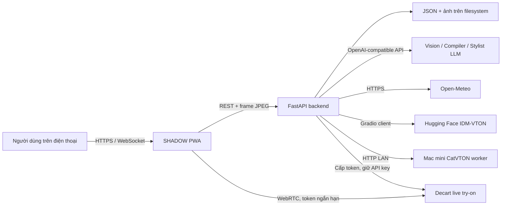
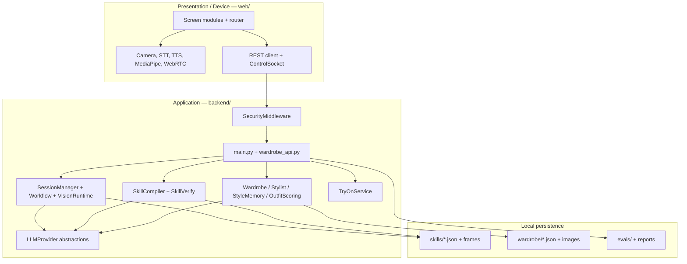
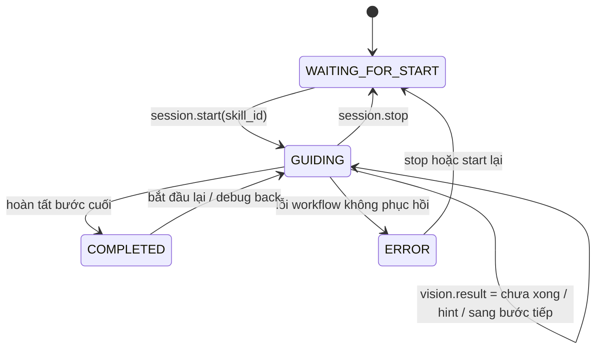
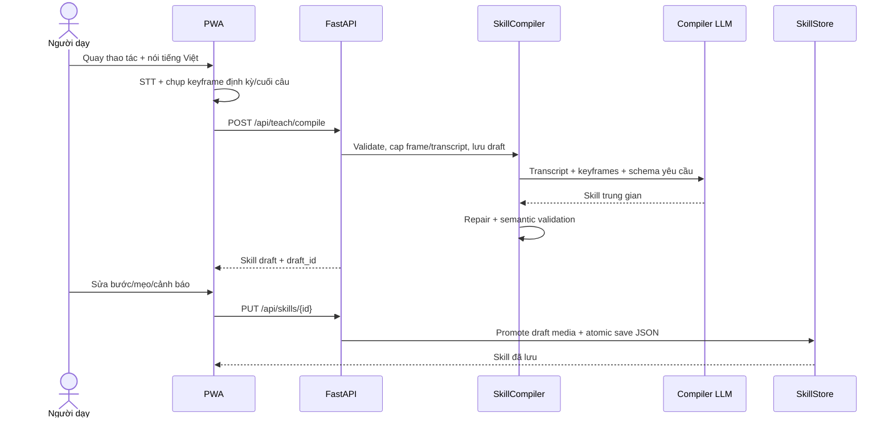
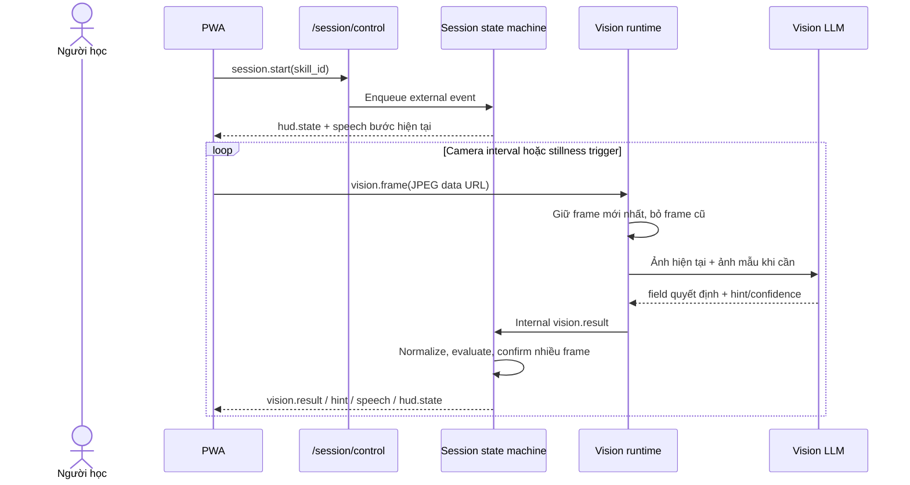

# SHADOW — Phân tích và thiết kế hệ thống

> **Tài liệu được tái dựng từ hiện trạng** — tạo từ `shadown-fourward/` ngày 2026-11-10 tại commit `dd2331d`.
> Tài liệu mô tả hệ thống đang hoạt động theo README và mã nguồn. Những nội dung ghi **SUY LUẬN** hoặc
> **INTENT UNKNOWN** chưa phải yêu cầu đã được chủ dự án xác nhận. Khi tài liệu khác với mã nguồn, không mặc định
> tài liệu là đặc tả bắt buộc.

## 1. Tóm tắt điều hành

SHADOW là trợ lý AI tiếng Việt chạy trên trình duyệt điện thoại, dùng camera và giọng nói để chuyển tri thức thực hành
của một người thành hướng dẫn có thể tái sử dụng. Sản phẩm có hai miền nghiệp vụ liên kết với nhau:

1. **Dạy và hướng dẫn kỹ năng**: người dạy thao tác trước camera và thuyết minh; AI biên dịch bản ghi thành một
   `Skill` gồm nhiều bước, ảnh mẫu, tiêu chí hoàn thành, mẹo và cảnh báo. Người học thực hiện lại; backend quan sát
   từng khung hình, điều khiển tiến trình và gửi câu thoại hướng dẫn.
2. **Trợ lý tủ đồ**: quản lý tủ đồ, hiểu món đồ qua ảnh, phối đồ theo thời tiết/sự kiện/luật được dạy/sở thích đã học,
   rồi cho mặc thử trực tiếp hoặc bằng ảnh.

Về kỹ thuật, SHADOW hiện là **modular monolith thiên về server-authoritative**:

- `web/` là PWA mobile-first bằng JavaScript thuần, chịu trách nhiệm camera, STT/TTS, giao diện và tối ưu gửi frame.
- `backend/` là một tiến trình FastAPI sở hữu API, state machine phiên hướng dẫn, điều phối LLM, lưu trữ file và
  kiểm soát bảo mật.
- `tryon-worker/` là compute node FastAPI độc lập, tùy chọn, chạy CatVTON trên Mac mini qua mạng LAN.
- Các dịch vụ ngoài gồm LLM OpenAI-compatible, Open-Meteo, Hugging Face Space và Decart.

Đây là kiến trúc hợp lý cho hackathon và demo: ít thành phần triển khai, có mock mode, có fallback và hoạt động được
ngay cả khi thiếu một số dịch vụ. Nó **chưa phải kiến trúc production đa người dùng** do dữ liệu lưu bằng JSON/file
cục bộ, trạng thái giới hạn tốc độ nằm trong RAM, không có định danh người dùng và chưa có hàng đợi bền vững.

## 2. Phạm vi và nguồn phân tích

### 2.1 Trong phạm vi

- Kiến trúc tổng thể của `shadown-fourward/`.
- Luồng Dạy → Xem lại → Lưu kỹ năng → Hướng dẫn.
- Luồng Tủ đồ → Phối đồ → Học sở thích → Mặc thử.
- Ranh giới module, dữ liệu, API, trạng thái, xử lý bất đồng bộ và fallback.
- Bảo mật demo, khả năng kiểm thử, điểm nghẽn và hướng tiến hóa.

### 2.2 Ngoài phạm vi

- Thiết kế chi tiết của dự án KMM trong `BaseKMM/`.
- Cam kết SLA/SLO production; repository chưa định nghĩa.
- Kiểm chứng chất lượng thực tế của CatVTON trên Mac mini và Decart; README xác nhận hai đường này chưa được thử
  đầy đủ trên thiết bị thật.
- Thay đổi schema, dependency hoặc mã nguồn runtime.

### 2.3 Nguồn sự thật

| Mức ưu tiên | Nguồn | Vai trò |
|---|---|---|
| 1 | `backend/`, `web/`, `tryon-worker/` | Hành vi đang được cài đặt |
| 2 | `README.md`, `tryon-worker/README.md` | Mô tả sản phẩm và vận hành |
| 3 | `PLAN.md`, `PROGRESS.md`, `docs/ROADMAP.md` | Ý định, lịch sử và kế hoạch |
| 4 | `NOTICE.md`, các file `SOURCES.md` | Nguồn gốc và ràng buộc giấy phép |

## 3. Mục tiêu thiết kế được suy ra

| Mục tiêu | Bằng chứng trong hệ thống | Hệ quả kiến trúc |
|---|---|---|
| Demo được ngay cả khi không có key/mạng | `SHADOW_MODE=mock`, mock compiler/vision/try-on | Mọi năng lực AI chính đều có đường mock hoặc fallback |
| Điện thoại là thiết bị tương tác chính | PWA, camera, microphone, HTTPS tunnel | Client phải nhẹ, không cần build native |
| Backend quyết định tiến trình | State machine và session loop lấy từ GlassKit | Tránh để client tự đánh dấu bước hoàn thành |
| Phản hồi đủ nhanh để hướng dẫn trực tiếp | Giảm ảnh, latest-frame-wins, interval tối thiểu | Ưu tiên độ mới của frame hơn xử lý đủ mọi frame |
| Giảm “nhảy bước” sai | Xác nhận nhiều frame liên tiếp, eval false-positive | Tính an toàn của quyết định quan trọng hơn độ nhạy tức thời |
| Dạy được bằng ngôn ngữ tự nhiên | Skill compiler và parser luật phối đồ | LLM sinh bản nháp; schema/validator và deterministic rules giữ biên an toàn |
| Suy giảm chức năng có kiểm soát | worker → HF → mock; AI → deterministic fallback | Hỏng dịch vụ ngoài không làm hỏng toàn bộ demo |

**INTENT UNKNOWN:** chưa rõ mục tiêu cuối là demo hackathon, sản phẩm cá nhân single-tenant hay nền tảng nhiều người dùng.
Quyết định này ảnh hưởng trực tiếp đến xác thực, lưu trữ, cách ly dữ liệu, chi phí và topology triển khai.

## 4. Bối cảnh hệ thống



### 4.1 Trust boundary

- Camera, microphone, Web Speech API và TTS nằm trên thiết bị người dùng.
- Browser không được nhận API key dài hạn của LLM hoặc Decart.
- Backend là ranh giới tin cậy trung tâm: validate input, quyết định bước, gọi dịch vụ trả phí và lưu dữ liệu.
- Mac mini worker là một trust boundary thứ hai; nếu đặt `TRYON_TOKEN`, backend gọi bằng shared secret.
- Ngrok chỉ là transport để browser có HTTPS; không thay thế xác thực ứng dụng.

## 5. Kiến trúc logic



### 5.1 Đặc trưng kiến trúc

- **Modular monolith**: cùng một process FastAPI nhưng chia module theo năng lực.
- **Server-authoritative session**: browser gửi sự kiện và ảnh; backend quyết định trạng thái chính thức.
- **Ports and adapters ở lớp AI**: `LLMProvider` che gateway thật và `MockProvider`.
- **File-backed repositories**: `SkillStore`, `WardrobeStore`, `EvalStore` đóng vai trò repository cục bộ.
- **Hybrid AI + deterministic control**: LLM tạo/nhận định; validator, state machine, scoring và rule engine kiểm soát
  kết quả trước khi dùng.
- **Graceful degradation**: ưu tiên chất lượng, sau đó giảm cấp về provider khác hoặc thuật toán tất định/mock.

## 6. Phân rã module và quyền sở hữu

### 6.1 PWA `web/`

| Module | Sở hữu | Không nên sở hữu |
|---|---|---|
| `app.js`, `js/screens/*` | Điều hướng và vòng đời từng màn hình | Quyết định nghiệp vụ cuối cùng |
| `camera.js`, `cv.js`, `tryon-pose.js` | Capture, resize, phát hiện đứng yên/tư thế cục bộ | Chấm hoàn thành bước |
| `speech.js` | STT/TTS, push-to-talk, trạng thái giọng nói | Prompt/key của model |
| `api.js`, `wardrobe-api.js`, `ws.js` | Hợp đồng truyền tải REST/WebSocket | Lưu trạng thái bền vững |
| `decart-live.js` | Phiên WebRTC mặc thử trực tiếp | Giữ `DECART_API_KEY` |

Client được xem là **thin client có device capability**: nó xử lý phần phụ thuộc thiết bị nhưng không phải nguồn sự
thật cho trạng thái kỹ năng.

### 6.2 API composition và bảo mật

- `main.py` khởi tạo provider, skill store và session manager trong FastAPI lifespan; đóng tài nguyên khi shutdown.
- `wardrobe_api.py` cung cấp toàn bộ API tủ đồ, thời tiết, stylist, feedback và try-on.
- `security.py` chặn request trước route: access code tùy chọn, body cap, token bucket theo IP, quota dịch vụ tốn tiền,
  giới hạn WebSocket, same-origin và security headers.

### 6.3 Dạy và quản lý kỹ năng

- `skill_compiler.py`: chuẩn hóa transcript/keyframe, giới hạn đầu vào, gọi compiler model hoặc mock, sửa output và
  tạo `Recipe` hợp lệ. Bản nháp có TTL 6 giờ.
- `skill_verify.py`: kiểm tra chất lượng từng bước và tạo dữ liệu eval từ frame của người dạy.
- `skill_store.py`: validate Pydantic + semantic rules, ghi JSON theo kiểu temp-file rồi replace, promote ảnh draft và
  chống path traversal/symlink escape khi phục vụ media.
- `recipe_catalog.py`: schema tương thích ngược với Recipe của GlassKit, mở rộng metadata SHADOW.

### 6.4 Runtime hướng dẫn

- `ShadowSessionManager` ghép `SessionWorkflowMixin` và `VisionRuntimeMixin`.
- Mỗi WebSocket tạo một `ControlSession`, một event queue và một session-loop tuần tự.
- `session_workflow.py` là state machine, quản lý bước, speech, xác nhận hoàn thành, hint, tip và lỗi.
- `vision_runtime.py` nhận frame, gọi model, chuẩn hóa output và đưa `vision.result` nội bộ vào event queue.
- Client không được bơm các internal event như `vision.result`; manager chỉ chấp nhận một allowlist sự kiện client.

### 6.5 Tủ đồ và stylist

- `wardrobe_store.py`: items, rules, ảnh và kết quả try-on; chuẩn hóa ảnh, cap kích thước, atomic JSON write và khóa
  trong process.
- `stylist.py`: gắn nhãn ảnh, hiểu đồ đang mặc, gọi stylist model, validate output và fallback sang picker tất định.
- `garment_attrs.py`: thuộc tính quần áo chuẩn hóa và migration-on-read cho dữ liệu cũ.
- `outfit_scoring.py`: chấm điểm deterministic, loại vi phạm hard constraint và xếp hạng bộ phối.
- `style_memory.py`: parse luật ngôn ngữ tự nhiên thành constraint, áp dụng `must/should`, ghi feedback, affinity có
  half-life 21 ngày, ví dụ của người dạy và lịch sử đã mặc.
- `weather.py`: Open-Meteo, timeout và cache 30 phút; kết quả không khả dụng được biểu diễn rõ thay vì làm hỏng flow.

### 6.6 Mặc thử

- `tryon.py`: điều phối ba provider ảnh theo chuỗi `worker → hf_space → mock` ở chế độ `auto`; hỗ trợ Decart token
  và prompt cho live try-on.
- `tryon-worker/server.py`: API `/health`, `/tryon`, xác thực token tùy chọn, một job chạy tại một thời điểm và hàng đợi
  có giới hạn.
- `pipeline_catvton.py`, `masker.py`: CatVTON được port cho MPS, SCHP mask, attention chunking và fallback fp32 khi
  fp16 sinh NaN.

## 7. Mô hình miền cốt lõi

### 7.1 Skill

```text
Skill/Recipe
 ├─ id, display_name, summary, learned_from, language, created_at
 ├─ detectors: detector_key -> RecipeDetector
 ├─ steps[]: RecipeStep
 │   ├─ instruction, tip, warning, reference_image
 │   ├─ detector_key, evaluation_mode
 │   └─ enter/mismatch/success/complete speech
 └─ start_step_id
```

Invariant quan trọng:

- `id` được slug hóa; đường dẫn media phải tương đối và nằm trong thư mục cho phép.
- Mỗi bước tham chiếu detector tồn tại và luồng bước phải hợp lệ.
- Output vision phải được normalize theo field/type mà detector khai báo.
- Frame “done” phải được xác nhận liên tiếp theo `COMPLETE_CONFIRM_FRAMES` trước khi chuyển bước.

### 7.2 Guide session



Trạng thái runtime chỉ tồn tại trong RAM và gắn với WebSocket. Mất kết nối sẽ hủy session; app có thể kết nối lại nhưng
không có checkpoint bền vững để tiếp tục chính xác cùng session sau khi process restart.

### 7.3 Wardrobe và style memory

- `WardrobeItem`: danh tính, category, màu, style, warmth, occasion, season, material, ảnh và thuộc tính dẫn xuất.
- `StyleRule`: câu người dạy, người dạy, strength, constraint có cấu trúc và trạng thái xác nhận.
- `StyleProfile`: feedback events, lịch sử mặc và affinity theo item/thuộc tính/ngữ cảnh.
- `TeacherExample`: tập item được dạy là một bộ tốt cho event/occasion.
- `OutfitSuggestion`: danh sách `item_ids`, lý do, mẹo, rule credits, score và explainability metadata.

## 8. Các luồng nghiệp vụ chính

### 8.1 Dạy một kỹ năng



Điểm kiểm soát: LLM không ghi thẳng dữ liệu bền vững; người dùng review và backend validate trước khi lưu.

### 8.2 Hướng dẫn thời gian thực



**Quyết định đúng:** latest-frame-wins tránh queue ảnh lỗi thời; event loop tuần tự tránh race khi chuyển bước; generation
counter loại kết quả vision cũ sau reset/chuyển runtime.

### 8.3 Phối đồ có luật và bộ nhớ

1. API tải items, rules và style memory.
2. Lấy thời tiết; nếu có ảnh hiện tại, chạy nhận diện song song với weather.
3. Xác định anchor item từ yêu cầu hoặc món đang mặc khớp tủ đồ.
4. Parse/apply `must` rule để loại item không hợp lệ trước khi sinh candidate.
5. Gọi stylist LLM; validate chỉ cho phép item thực sự tồn tại.
6. `outfit_scoring` loại hard-rule violation và xếp hạng.
7. Nếu LLM lỗi/không hợp lệ/thiếu số lượng, picker tất định bổ sung candidate.
8. `style_memory.finalize` sửa, xếp hạng lại theo luật, feedback, ví dụ và lịch sử; trả explainability/rules used.

Thiết kế này tránh phụ thuộc hoàn toàn vào LLM: model sinh phương án và lời giải thích, còn tính hợp lệ cơ bản được
kiểm soát bằng code.

### 8.4 Mặc thử ảnh

1. Chuẩn hóa ảnh người và ảnh đồ; lập kế hoạch pass `upper/lower/overall`.
2. Chọn provider chain theo cấu hình và health check.
3. Mac mini worker có thể chạy tuần tự áo rồi quần; output pass trước là input pass sau.
4. HF IDM-VTON chỉ xử lý upper/overall; lower được ghi là skipped thay vì báo thành công giả.
5. Nếu provider auto thất bại, chuyển provider kế tiếp; nếu cấu hình ép provider, lỗi được trả thẳng.
6. Kết quả JPEG lưu vào `wardrobe/tryon/`, chỉ giữ tối đa 100 ảnh gần nhất.

## 9. Hợp đồng giao tiếp

### 9.1 REST API theo capability

| Capability | Endpoint chính |
|---|---|
| Health/access | `GET /api/health`, `POST /api/access` |
| Skill CRUD | `GET/PUT/DELETE /api/skills...` |
| Teach/verify | `POST /api/teach/compile`, `GET /api/teach/progress/{job_id}`, `POST /api/teach/verify-step` |
| Hỏi trong bước | `POST /api/ask` |
| Eval | `POST /api/eval/capture`, `GET /api/eval/{skill_id}` |
| Wardrobe | CRUD `/api/wardrobe/items`, seed/import, rules, examples |
| Stylist learning | `POST /api/stylist/suggest`, `POST /api/stylist/feedback`, profile read/reset |
| Weather | `GET /api/weather` |
| Try-on | config, live token/prompt, photo try-on |
| Media | `/skills-media/...`, `/wardrobe-media/...` |

### 9.2 WebSocket `/session/control`

Client event hợp lệ gồm `session.start`, `session.stop`, `debug.step`, và đường riêng cho `vision.frame`. Server trả
`session.ready`, `hud.state`, `speech`, `vision.result`, `hud.error`. `speech_epoch` giúp client bỏ/ghi đè câu thoại cũ.

### 9.3 API worker

- `GET /health`: trạng thái model/device/warm/busy/queue.
- `POST /tryon`: ảnh người, ảnh đồ, category và tuning tùy chọn; trả ảnh, thời gian, seed, mask metadata.
- Xác thực tùy chọn qua `X-Tryon-Token`.

## 10. Dữ liệu và tính nhất quán

| Dữ liệu | Vị trí | Cơ chế nhất quán | Giới hạn hiện tại |
|---|---|---|---|
| Skills | `backend/skills/*.json` + thư mục ảnh | Temp write + atomic replace | Không versioning, không multi-tenant |
| Teach drafts | `backend/skills/_drafts/` | TTL + promote khi lưu | Mất khi xóa/di chuyển máy |
| Wardrobe | `backend/wardrobe/items.json`, `rules.json` | `RLock` + atomic JSON write | Khóa chỉ trong một process |
| Style memory | JSON profile/examples | `RLock`, cap số event | Không giao dịch xuyên nhiều file |
| Eval | `backend/evals/` | File-based | Dành cho nghiên cứu/demo |
| Try-on outputs | `backend/wardrobe/tryon/` | UUID + prune 100 ảnh | Không có retention policy theo user |
| Session | RAM | Queue tuần tự theo session | Không resume sau restart |

Kết luận: filesystem phù hợp single-node/single-team. Chạy nhiều worker Uvicorn hoặc nhiều replica có thể gây lost update,
session lệch node và quota không đồng bộ. Không nên scale ngang trước khi tách persistence/session state.

## 11. Đồng thời, backpressure và hiệu năng

- Mỗi guide session có một event loop tuần tự và tối đa một vision worker.
- Khi frame đến nhanh hơn model, chỉ frame mới nhất được giữ; đây là backpressure dạng coalescing.
- Vision có min interval, timeout riêng, exponential backoff khi lỗi và fast-confirm cho frame xác nhận kế tiếp.
- Hint có rate limit, chống lặp theo độ giống text và có thể tách thành lazy call khi dùng logprob decision.
- Stylist có timeout và fallback deterministic; weather có cache 30 phút.
- Photo try-on bị giới hạn concurrency toàn server; HF call có lock để không chồng hàng đợi public Space.
- CatVTON worker chạy một inference tại một thời điểm, queue có cap; attention chunking đổi tốc độ lấy bộ nhớ ổn định.

Điểm nghẽn chính theo thiết kế: latency/cost của LLM, inference ảnh mặc thử, băng thông base64 và single-process file I/O.
Base64 đơn giản cho demo nhưng tăng kích thước khoảng 33%; production nên cân nhắc upload nhị phân/object storage.

## 12. Bảo mật và quyền riêng tư

### 12.1 Kiểm soát đã có

- Secret nằm trong `.env`; browser chỉ nhận Decart token ngắn hạn.
- Access code tùy chọn, cookie HMAC `HttpOnly`, `SameSite=Lax`, `Secure` khi HTTPS.
- Body size cap, rate limit theo IP, quota endpoint tốn tiền và giới hạn concurrent try-on.
- Same-origin WebSocket, cap socket theo IP/toàn server, rate limit message.
- Validate image size/pixel count; safe ID/path; chống path traversal và symlink escape.
- Security headers: `nosniff`, referrer same-origin, deny framing.
- Lỗi provider được rút gọn trước khi gửi client để hạn chế lộ URL/path nội bộ.

### 12.2 Khoảng trống trước production

- Access code là cổng demo dùng chung, không phải user authentication/authorization.
- Không có mã hóa dữ liệu at-rest, consent record, audit log hay chính sách xóa ảnh theo người dùng.
- Ảnh người/đồ và transcript có thể được gửi tới nhà cung cấp AI ngoài; cần disclosure và consent rõ ràng.
- Rate limit/quota trong RAM mất khi restart và không dùng chung giữa replica.
- Cần threat model riêng cho prompt injection qua transcript, rule text, tên món đồ và nội dung ảnh.
- Cần kiểm tra SSRF đối với luồng import shop nếu URL do client kiểm soát; tài liệu này chưa xác nhận endpoint đủ an toàn
  để mở public ngoài phạm vi demo.

## 13. Độ tin cậy và chiến lược suy giảm

| Failure | Hành vi hiện tại | Đánh giá |
|---|---|---|
| Không có LLM key | Chạy mock | Tốt cho demo, phải hiển thị rõ để không nhầm là AI thật |
| Vision timeout/error | Báo trạng thái, backoff, giữ session | Hợp lý; không có durable retry |
| LLM stylist lỗi/output sai | Deterministic picker | Tốt, vẫn trả kết quả hợp lệ |
| Weather lỗi | Trả unavailable, flow vẫn tiếp tục | Tốt |
| Worker Mac mini lỗi | HF rồi mock ở auto mode | Tốt cho demo; mock phải được gắn nhãn |
| HF hết quota | Backoff và bỏ qua tạm thời | Tránh lặp lỗi tốn thời gian |
| WebSocket mất | Session bị hủy | Đơn giản nhưng không resume |
| Backend restart | Mất session/quota/cache | Chấp nhận cho prototype, không đạt production HA |

## 14. Quan sát, eval và kiểm thử

- Backend dùng logging của Uvicorn cho session, latency, provider failure và fallback.
- Eval pipeline lưu frame có nhãn, so model theo accuracy, false-complete, miss, p50/p95; false-complete được ưu tiên vì
  tác động trực tiếp đến nhảy bước.
- README ghi kết quả 20 ảnh “pha trà”: 90% accuracy; Qwen3-VL-8B nhanh hơn model compiler nên được chọn cho vision.
- Test suite bao phủ workflow, confirm frames, provider, compiler/store, security, wardrobe, stylist, scoring, memory,
  weather và try-on; worker có test server/mask/pipeline riêng.

**Trạng thái xác minh tài liệu:** chưa chạy được `pytest` trong môi trường hiện tại vì repository không có `.venv` và
Python hệ thống không cài `pytest`. Vì vậy con số “115 test” trong README được ghi nhận là tuyên bố của README, chưa
được tái xác nhận ở commit này.

## 15. Ràng buộc và nợ kỹ thuật

### 15.1 Ràng buộc sản phẩm/pháp lý

- CatVTON và IDM-VTON là CC BY-NC-SA; nhánh mặc thử ảnh hiện chỉ phù hợp demo/nghiên cứu phi thương mại.
- Ảnh seed YaMe chỉ dùng demo nội bộ, không được phân phối lại.
- Open-Meteo cần tuân thủ attribution/điều khoản tương ứng.
- Decart là dịch vụ trả phí; cần cost guard và chính sách hết hạn phiên.

### 15.2 Nợ kỹ thuật quan trọng

1. **README/PLAN chưa phản ánh hết mã nguồn mới**: style memory, feedback/profile, examples, deterministic scoring,
   import shop và verify-step cần được bổ sung vào tài liệu API chính.
2. **Persistence single-node**: JSON/file và lock trong process không an toàn cho multi-process/multi-replica.
3. **Không có identity/tenant boundary**: mọi người dùng cùng deployment nhìn chung chia sẻ skills và wardrobe.
4. **Session không bền vững**: không resume sau restart hoặc reconnect sang instance khác.
5. **`main.py`/`wardrobe_api.py` là composition root lớn**: API, background job và capability wiring đang tập trung;
   khi sản phẩm lớn hơn nên tách router/service theo bounded context.
6. **Observability chủ yếu là log text**: thiếu request ID xuyên dịch vụ, metrics, tracing và cost telemetry.
7. **External contracts chưa được version hóa**: PWA, backend và worker chưa có `/api/v1` hoặc schema compatibility policy.

## 16. Kiến trúc mục tiêu đề xuất

### 16.1 Giai đoạn 0 — Giữ kiến trúc demo, làm rõ boundary

- Giữ một FastAPI process và filesystem.
- Tách tài liệu API/schema thành nguồn sự thật sinh được hoặc test được.
- Thêm request/session correlation ID, structured logging và thống kê latency/cost/fallback.
- Đóng gói service interfaces cho skill, guide, wardrobe, stylist và try-on; chưa cần microservice.
- Đồng bộ README với capability thực tế.

### 16.2 Giai đoạn 1 — Tích hợp KMM

- Xem SHADOW backend là BFF/AI orchestration service; KMM gọi REST/WebSocket qua contract ổn định.
- Version API (`/api/v1`) và xuất OpenAPI/schema; giữ primitive ID qua navigation phía KMM.
- Định nghĩa rõ ownership: KMM sở hữu UI/native permissions; backend sở hữu AI orchestration và quyết định session.
- Có migration path cho dữ liệu local hiện tại, không cho app native đọc trực tiếp JSON của backend.

### 16.3 Giai đoạn 2 — Production single-region

- Thêm identity và tenant/user boundary.
- Chuyển metadata sang PostgreSQL; ảnh sang object storage; Redis cho session/rate limit/cache.
- Đưa job dài (compile, verify, photo try-on) vào durable queue; API trả job ID/progress.
- Thêm retention/consent/delete workflow cho ảnh và transcript.
- Giữ try-on worker là worker pool riêng có health, queue depth và autoscaling policy.

### 16.4 Giai đoạn 3 — Scale khi có bằng chứng tải

- Chỉ tách service theo bounded context khi có nhu cầu scale hoặc ownership độc lập:
  `Guide Runtime`, `Skill Authoring`, `Wardrobe/Stylist`, `Try-on Orchestrator`.
- Không tách microservice sớm; hiện latency chủ yếu ở external AI, không nằm ở call nội bộ.

## 17. Các quyết định kiến trúc nên lập ADR

| Ưu tiên | ADR cần có | Lý do |
|---|---|---|
| Cao | Mục tiêu deployment: demo single-tenant hay production multi-tenant | Quyết định mọi lựa chọn lưu trữ và auth |
| Cao | Ownership giữa KMM và SHADOW backend | Tránh trùng state/business rule giữa native và server |
| Cao | API versioning và compatibility policy | Bảo vệ client KMM/PWA khi backend tiến hóa |
| Cao | Persistence migration: JSON → database/object storage | Điều kiện để chạy nhiều process/replica |
| Cao | Privacy/retention cho camera, ảnh người và transcript | Dữ liệu nhạy cảm và gửi sang vendor ngoài |
| Trung bình | Durable job model cho compile/verify/try-on | Giảm timeout và hỗ trợ resume/progress |
| Trung bình | Provider selection, cost budget và circuit breaker | Kiểm soát chi phí và độ tin cậy |
| Trung bình | Commercial replacement cho model NC | Điều kiện thương mại hóa tính năng try-on |

## 18. Câu hỏi mở

1. SHADOW sẽ tiếp tục là ứng dụng độc lập, hay `BaseKMM` sẽ thay PWA làm client chính?
2. Một deployment phục vụ một gia đình/nhóm hay nhiều người dùng không tin cậy lẫn nhau?
3. Skill do người dùng tạo có cần chia sẻ, version, duyệt và rollback không?
4. Có yêu cầu tiếp tục guide sau mất mạng/restart không, và checkpoint ở mức bước hay frame?
5. Ảnh camera/transcript được giữ bao lâu, ai được xóa, và vendor nào được phép nhận dữ liệu?
6. Tính năng mặc thử có định hướng thương mại không? Nếu có, model/ảnh seed hiện tại không đáp ứng giấy phép.
7. SLO mục tiêu cho vision feedback, compile skill, stylist và try-on là bao nhiêu?
8. Luật được dạy là gợi ý cá nhân hay policy bắt buộc; ai có quyền sửa/xác nhận rule parse?

## 19. Kết luận

Điểm mạnh nhất của SHADOW không chỉ là “gọi AI nhìn camera”, mà là cách hệ thống đặt AI bên trong một vòng kiểm soát:
schema hóa tri thức, cho người dạy review, state machine quyết định tiến trình, xác nhận nhiều frame, deterministic rule
enforcement, eval false-positive và fallback có chủ đích. Đây là nền tảng tốt để phát triển tiếp.

Ranh giới cần bảo vệ khi tiến hóa là: **client thu nhận và trình bày; backend quyết định và điều phối; AI đề xuất/nhận
định nhưng không tự ghi trạng thái bền vững; deterministic code kiểm tra invariant; provider ngoài luôn có timeout,
giới hạn và phương án suy giảm**. Trước khi mở rộng quy mô, dự án cần chốt mục tiêu deployment, quyền riêng tư, ownership
với KMM và chiến lược persistence; nếu chưa có bốn quyết định này, việc chuyển sang microservice hoặc cloud scale sẽ chỉ
phóng đại sự mơ hồ hiện tại.
